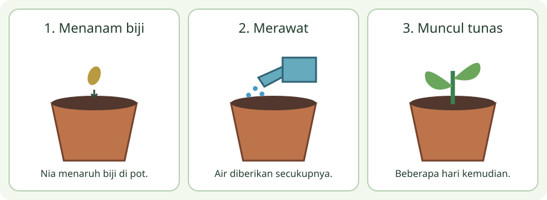

# Kelas 1 — Bab 3: Membaca Cerita Bergambar

[Daftar paket](../../README.md)

Pulau Kata bersama Bobo. Bahan ajar orisinal berdasarkan pilihan topik aplikasi. Draf menunggu review guru; bukan daftar bab resmi nasional.

Urutan empat bab per kelas adalah pilihan aplikasi, bukan daftar isi resmi. Cakupan dan penempatan topik, termasuk ratusan, bilangan negatif, lingkaran dan statistika, menunggu pemeriksaan CP/ATP oleh guru.

## Tujuan dan bekal awal

1. Menjelaskan mengamati gambar dan membaca teks dengan contoh dan alasan.
2. Menjelaskan mengurutkan awal, tengah, akhir dengan contoh dan alasan.
3. Menjelaskan menceritakan kembali dengan kata sendiri dengan contoh dan alasan.
Mulai dengan mengingat contoh sehari-hari yang berkaitan. Bila belum mengenal kata atau langkah pada judul, minta pendamping menjelaskannya dahulu. Tujuan ini masih draf untuk ditinjau guru.

## Sebelum mulai

Cerita bergambar memakai tulisan dan gambar untuk membantu menyampaikan kejadian. Kita akan membaca kisah orisinal pendek: Nia membawa biji. Ia menanamnya di pot. Setiap pagi Nia menyiram secukupnya. Beberapa hari kemudian muncul tunas.

## A. Mengamati gambar dan membaca teks

Perhatikan tokoh, benda dan tempat pada gambar, lalu baca tulisan yang menyertainya. Gambar memberi petunjuk, tetapi tidak semua informasi boleh ditebak. Bedakan yang terlihat jelas, yang tertulis, dan yang baru dugaanmu. Jika gambar dan dugaan berbeda, kembali ke bukti tulisan.

## Contoh bertahap 1

Jika gambar menunjukkan pot dan teks menyebut Nia menanam biji, kita tahu yang ditanam biji. Warna bunga masa depan belum dapat diketahui karena belum disebutkan.

## B. Mengurutkan awal, tengah, akhir

Tanyakan kejadian apa yang terjadi lebih dulu. Kata lalu, setelah itu, kemudian membantu melihat urutan. Pada cerita Nia, menanam mendahului merawat, dan tunas muncul setelah beberapa hari. Urutan yang masuk akal tidak selalu sama dengan urutan gambar yang diacak; cocokkan dengan teks.

## Contoh bertahap 2

Awal: Nia membawa biji. Tengah: ia menanam dan merawat. Akhir: tunas muncul. Tunas tidak muncul sebelum biji ditanam dalam kisah tersebut.

## C. Menceritakan kembali dengan kata sendiri

Sebut tokoh dan kejadian penting, kemudian ceritakan berurutan dalam kalimat pendek. Jangan harus menghafal semua kata. Gunakan pertanyaan siapa, apa dan bagaimana sebagai bantuan. Perasaan tokoh dapat ditafsirkan jika ada bukti; katakan mungkin bila belum jelas, bukan mengaku pasti.

## Contoh bertahap 3

Nia menanam biji dan menyiramnya. Setelah beberapa hari, biji bertunas. Dua kalimat ini mempertahankan kejadian utama tanpa menyalin seluruh bacaan.

## Kegiatan penerapan

Gambar tiga panel cerita berbeda tentang mengembalikan buku: meminjam, membaca, mengembalikan. Tulis satu kalimat tiap panel. Acak urutan dan minta teman menyusunnya serta menjelaskan bukti kata/gambar.

## Latihan mandiri

1. Siapa tokoh pada cerita Nia?
2. Apa yang terjadi sebelum tunas muncul?
3. Apakah teks memastikan warna bunga?
Cobalah dahulu tanpa membuka pembahasan. Untuk jawaban terbuka, tunjukkan alasan atau karya; lebih dari satu jawaban dapat diterima jika memenuhi pertanyaan dan didukung bukti.

## Pembahasan latihan mandiri

1. Nia Namanya disebut sebagai pelaku kegiatan.
2. Biji ditanam dan dirawat. Teks menyebut kegiatan itu lebih dahulu.
3. Tidak Belum ada informasi bunga atau warnanya.

## Rangkuman bab

Cocokkan gambar dengan tulisan, temukan urutan, dan ceritakan kembali kejadian penting. Pisahkan bukti dari dugaan.

## Refleksi belajar

Jelaskan satu gagasan dengan kata sendiri, tunjukkan satu contoh baru, dan sebutkan bagian yang masih perlu bantuan. Periksa kembali contoh jika jawaban belum tepat. Kesalahan memberi petunjuk langkah yang perlu dilatih; kamu boleh mengulang sebelum kuis.

## Catatan pendamping: bantuan dan pengayaan

Jika anak menebak dari gambar saja, tutup gambar sebentar dan baca kata bersama. Pengayaan: buat akhir alternatif dengan menandainya sebagai karangan baru.
Nilai pemahaman dengan bukti teks, keruntutan gagasan, ketepatan bahasa dan perbaikan setelah umpan balik. Tugas berbicara/menulis dinilai dari karya atau penyampaian, bukan skor pilihan ganda saja; bentuk lisan/dikte/alat bantu dapat disesuaikan.
Gunakan rubrik 0 = belum tampak, 1 = dengan banyak bantuan, 2 = sebagian mandiri, 3 = mandiri disertai alasan pada tiap kriteria. Catat bukti dan bantuan yang diperlukan; kriteria ketercapaian disepakati guru, bukan otomatis ditentukan XP.

## Kuis akhir bab

Lima soal interaktif tersedia pada aplikasi. Latihan mandiri di atas memakai contoh berbeda. Pendamping dapat meninjau bank lengkap pada [panduan kuis](../../KUIS-PENDAMPING.md).

## Sumber pendamping

- [Bahasa Indonesia: Aku Bisa! (Edisi Revisi)](https://buku.kemendikdasmen.go.id/katalog/bahasa-indonesia-aku-bisa-untuk-sd-mi-kelas-i-edisi-revisi)

[Lanjut bab 4](bab-04.md)
