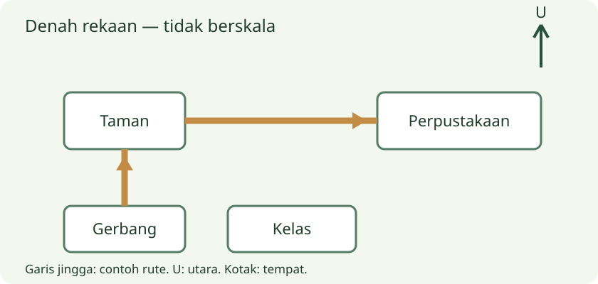

# Kelas 3 — Bab 3: Membaca Petunjuk & Denah Lokasi

[Daftar paket](../../README.md)

Pulau Kata bersama Bobo. Bahan ajar orisinal berdasarkan pilihan topik aplikasi. Draf menunggu review guru; bukan daftar bab resmi nasional.

Urutan empat bab per kelas adalah pilihan aplikasi, bukan daftar isi resmi. Cakupan dan penempatan topik, termasuk ratusan, bilangan negatif, lingkaran dan statistika, menunggu pemeriksaan CP/ATP oleh guru.

## Tujuan dan bekal awal

1. Menjelaskan urutan petunjuk dan syarat dengan contoh dan alasan.
2. Menjelaskan legenda dan arah mata angin dengan contoh dan alasan.
3. Menjelaskan menjelaskan rute dengan acuan dengan contoh dan alasan.
Mulai dengan mengingat contoh sehari-hari yang berkaitan. Bila belum mengenal kata atau langkah pada judul, minta pendamping menjelaskannya dahulu. Tujuan ini masih draf untuk ditinjau guru.

## Sebelum mulai

Petunjuk membantu melakukan langkah; denah menunjukkan letak. Baca seluruh informasi sebelum bergerak. Gunakan denah tempat rekaan untuk belajar dan tetap minta pendamping saat bepergian sungguhan.

## A. Urutan petunjuk dan syarat

Petunjuk biasanya memakai langkah bernomor atau kata urutan. Identifikasi alat, tindakan dan syarat keselamatan. Kerjakan menurut urutan bila langkah saling bergantung. Jika ada kalimat jika, perhatikan kondisinya. Setelah melakukan langkah, periksa apakah hasilnya sesuai tujuan, bukan sekadar semua nomor terlewati.

## Contoh bertahap 1

Petunjuk penanda buku: siapkan kertas, lipat dua, beri nama, lalu hias. Menghias sebelum menulis nama bisa menyulitkan bila ruang nama tertutup.

## B. Legenda dan arah mata angin

Denah adalah gambaran sederhana letak dilihat dari atas. Baca judul, tanda utara dan legenda simbol. Jika utara di atas, timur berada di kanan, selatan bawah dan barat kiri. Jangan menganggap atas kertas selalu utara jika panah menunjukkan arah lain. Legenda menjelaskan simbol, bukan ukuran sebenarnya.

## Contoh bertahap 2

Pada denah dengan utara di atas, perpustakaan di sebelah timur kelas berarti di kanan kelas. Kotak bertanda P dapat berarti perpustakaan jika legenda menyatakannya.

## C. Menjelaskan rute dengan acuan

Tentukan titik awal dan tujuan. Sebut arah gerak serta patokan yang terlihat pada denah. Bedakan belok kanan relatif arah berjalan dengan timur yang tetap menurut mata angin. Periksa rute tidak melewati penghalang. Jarak tepat tidak bisa dihitung dari denah tanpa skala atau informasi panjang.

## Contoh bertahap 3

Dari gerbang berjalan ke utara sampai taman, lalu ke timur ke perpustakaan. Rute ini lebih jelas daripada ke sana lalu ke situ karena memakai arah dan patokan.

## Kegiatan penerapan

Gambar denah rekaan empat tempat dengan tanda utara dan legenda. Tuliskan rute dari gerbang ke perpustakaan. Teman mengikuti dengan pion, menunjukkan belokan dan memeriksa apakah ada informasi yang kurang.

## Latihan mandiri

1. Utara di atas, barat di sisi mana?
2. Apa fungsi legenda?
3. Denah tanpa skala dapat memastikan jarak 200 meter?
Cobalah dahulu tanpa membuka pembahasan. Untuk jawaban terbuka, tunjukkan alasan atau karya; lebih dari satu jawaban dapat diterima jika memenuhi pertanyaan dan didukung bukti.

## Pembahasan latihan mandiri

1. Kiri. Mata angin pada orientasi itu menempatkan barat di kiri.
2. Menjelaskan arti simbol. Simbol tidak boleh ditebak tanpa keterangan.
3. Tidak. Diperlukan skala atau informasi panjang.

## Rangkuman bab

Petunjuk memerlukan urutan dan syarat; denah memerlukan orientasi dan legenda. Jelaskan rute dengan titik awal, arah dan patokan.

## Refleksi belajar

Jelaskan satu gagasan dengan kata sendiri, tunjukkan satu contoh baru, dan sebutkan bagian yang masih perlu bantuan. Periksa kembali contoh jika jawaban belum tepat. Kesalahan memberi petunjuk langkah yang perlu dilatih; kamu boleh mengulang sebelum kuis.

## Catatan pendamping: bantuan dan pengayaan

Jika kanan tertukar dengan timur, putar pion dan tunjukkan kanan relatif terhadap arah hadapnya. Pengayaan: denah yang panah utaranya tidak menghadap atas.
Nilai pemahaman dengan bukti teks, keruntutan gagasan, ketepatan bahasa dan perbaikan setelah umpan balik. Tugas berbicara/menulis dinilai dari karya atau penyampaian, bukan skor pilihan ganda saja; bentuk lisan/dikte/alat bantu dapat disesuaikan.
Gunakan rubrik 0 = belum tampak, 1 = dengan banyak bantuan, 2 = sebagian mandiri, 3 = mandiri disertai alasan pada tiap kriteria. Catat bukti dan bantuan yang diperlukan; kriteria ketercapaian disepakati guru, bukan otomatis ditentukan XP.

## Kuis akhir bab

Lima soal interaktif tersedia pada aplikasi. Latihan mandiri di atas memakai contoh berbeda. Pendamping dapat meninjau bank lengkap pada [panduan kuis](../../KUIS-PENDAMPING.md).

## Sumber pendamping

- [Bahasa Indonesia: Kawan Seiring (Edisi Revisi)](https://buku.kemendikdasmen.go.id/katalog/bahasa-indonesia-kawan-seiring-untuk-sdmi-kelas-iii-edisi-revisi)

[Lanjut bab 4](bab-04.md)
