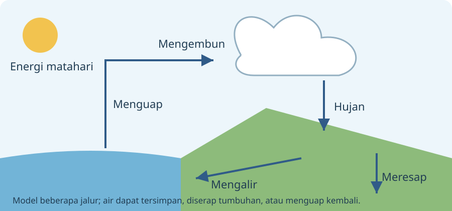

# Kelas 4 — Bab 4: Siklus Air & Pelestarian Alam

[Daftar paket](../../README.md)

Pulau Eksplora bersama Ilmuwan Tobi. Bahan ajar orisinal berdasarkan pilihan topik aplikasi. Draf menunggu review guru; bukan daftar bab resmi nasional.

Paket ini berfokus sains; unsur sosial IPAS tetap perlu paket lain. Topik dan penempatan kelas adalah pilihan aplikasi yang menunggu pemetaan TP/ATP dan review guru.

## Tujuan dan bekal awal

1. Menjelaskan penguapan dan pembentukan awan dengan contoh dan alasan.
2. Menjelaskan hujan, aliran dan peresapan dengan contoh dan alasan.
3. Menjelaskan pelestarian dan bukti tindakan dengan contoh dan alasan.
Mulai dengan mengingat contoh sehari-hari yang berkaitan. Bila belum mengenal kata atau langkah pada judul, minta pendamping menjelaskannya dahulu. Tujuan ini masih draf untuk ditinjau guru.

## Sebelum mulai

Air bergerak melalui udara, permukaan dan tanah dalam siklus. Matahari memberi energi bagi penguapan dan gravitasi membantu air bergerak turun. Menjaga air berarti menjaga jumlah yang tersedia serta kualitas dan tempat peresapannya.

## A. Penguapan dan pembentukan awan

Air menguap dari laut, danau, sungai atau permukaan lain. Tumbuhan juga melepaskan uap melalui transpirasi. Uap dapat mendingin lalu mengembun menjadi tetes kecil atau membentuk kristal es di awan. Awan terlihat karena tetes/kristal, sedangkan uap air gas tidak terlihat. Tidak semua awan menghasilkan hujan di lokasi yang sama.

## Contoh bertahap 1

Air jemuran menguap tanpa harus mendidih. Di atmosfer, perubahan kondisi dapat membuat uap menjadi tetes kecil; awan bukan kantong berlubang berisi air.

## B. Hujan, aliran dan peresapan

Tetes atau kristal yang tumbuh cukup besar dapat jatuh sebagai presipitasi, misalnya hujan. Air dapat mengalir ke sungai/laut, meresap ke tanah, tersimpan atau menguap lagi. Permukaan kedap mengurangi peresapan dan dapat meningkatkan limpasan. Jalur air beragam, tidak semua tetes langsung kembali ke laut.

## Contoh bertahap 2

Air hujan di taman berpori dapat meresap. Di halaman tertutup beton, lebih banyak air dapat mengalir menuju saluran, tergantung kondisi dan rancangan tempat.

## C. Pelestarian dan bukti tindakan

Jaga daerah resapan, rawat tanaman sesuai lingkungan, hemat air bersih dan hindari membuang sampah/limbah. Siklus air tidak menjamin air yang tercemar langsung aman diminum. Banjir mempunyai banyak faktor; jangan menyalahkan satu orang atau satu kejadian tanpa data. Tindakan disesuaikan kondisi setempat dengan pendamping.

## Contoh bertahap 3

Menutup keran setelah dipakai mengurangi pemborosan. Memilah sampah menjaga saluran, tetapi tidak sendirian menyelesaikan seluruh risiko banjir atau pencemaran.

## Kegiatan penerapan

Buat diagram siklus dengan panah berlabel menguap, mengembun, hujan, mengalir dan meresap. Tambahkan dua titik tindakan pelestarian. Amati peresapan hanya pada tanah/wadah aman bersama pendamping, bukan mendekati saluran banjir.

## Latihan mandiri

1. Sumber energi utama penguapan pada siklus air?
2. Apa yang terjadi saat infiltrasi?
3. Air siklus alam selalu aman diminum langsung?
Cobalah dahulu tanpa membuka pembahasan. Untuk jawaban terbuka, tunjukkan alasan atau karya; lebih dari satu jawaban dapat diterima jika memenuhi pertanyaan dan didukung bukti.

## Pembahasan latihan mandiri

1. Matahari. Energi matahari mendukung perubahan air cair menjadi uap.
2. Air meresap ke tanah. Berbeda dari aliran di permukaan.
3. Tidak. Kualitas dan pengolahan tetap perlu diperhatikan.

## Rangkuman bab

Siklus melibatkan penguapan, pengembunan, presipitasi, aliran dan peresapan. Pelestarian menjaga tempat resapan serta kualitas air.

## Refleksi belajar

Jelaskan satu gagasan dengan kata sendiri, tunjukkan satu contoh baru, dan sebutkan bagian yang masih perlu bantuan. Periksa kembali contoh jika jawaban belum tepat. Kesalahan memberi petunjuk langkah yang perlu dilatih; kamu boleh mengulang sebelum kuis.

## Catatan pendamping: bantuan dan pengayaan

Jangan menggambar siklus hanya satu jalur wajib. Pengayaan: dua daerah dengan permukaan berbeda dan dampaknya pada limpasan/peresapan.
Nilai pertanyaan pengamatan, catatan bukti, penjelasan hubungan, batas kesimpulan dan keselamatan. Bedakan yang diamati dari yang dipelajari dari sumber. Jangan meminta percobaan berisiko atau menilai tubuh/kemampuan pribadi teman.
Gunakan rubrik 0 = belum tampak, 1 = dengan banyak bantuan, 2 = sebagian mandiri, 3 = mandiri disertai alasan pada tiap kriteria. Catat bukti dan bantuan yang diperlukan; kriteria ketercapaian disepakati guru, bukan otomatis ditentukan XP.

## Kuis akhir bab

Lima soal interaktif tersedia pada aplikasi. Latihan mandiri di atas memakai contoh berbeda. Pendamping dapat meninjau bank lengkap pada [panduan kuis](../../KUIS-PENDAMPING.md).

## Sumber pendamping

- [Buku Interaktif IPAS Kelas IV (Edisi Revisi)](https://buku.kemendikdasmen.go.id/katalog/buku-interaktif-ilmu-pengetahuan-alam-dan-sosial-untuk-sd-mi-kelas-iv-edisi-revisi)
- [Panduan mata pelajaran IPAS Fase B dan C, 2025](https://repositori.kemendikdasmen.go.id/33599/)

Selesai satu paket kelas/pelajaran. Tinjau bagian yang belum dikuasai sebelum memilih paket berikutnya.
