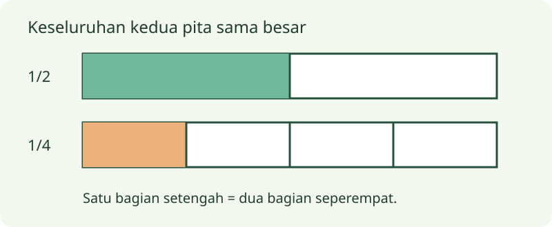

# Kelas 3 — Bab 4: Mengenal Pecahan Sederhana

[Daftar paket](../../README.md)

Pulau Numeria bersama Kapten Rubi. Bahan ajar orisinal berdasarkan pilihan topik aplikasi. Draf menunggu review guru; bukan daftar bab resmi nasional.

Urutan empat bab per kelas adalah pilihan aplikasi, bukan daftar isi resmi. Cakupan dan penempatan topik, termasuk ratusan, bilangan negatif, lingkaran dan statistika, menunggu pemeriksaan CP/ATP oleh guru.

## Tujuan dan bekal awal

1. Menjelaskan membagi sama besar dengan contoh dan alasan.
2. Menjelaskan pembilang dan penyebut dengan contoh dan alasan.
3. Menjelaskan membandingkan pecahan satuan dengan contoh dan alasan.
Mulai dengan mengingat contoh sehari-hari yang berkaitan. Bila belum mengenal kata atau langkah pada judul, minta pendamping menjelaskannya dahulu. Tujuan ini masih draf untuk ditinjau guru.

## Sebelum mulai

Pecahan menyatakan bagian dari keseluruhan yang dibagi sama besar. Keseluruhannya harus jelas: setengah satu pita tidak dapat dibandingkan langsung dengan setengah pita lain yang panjangnya berbeda.

## A. Membagi sama besar

Lipat gambar persegi panjang menjadi dua, tiga, atau empat bagian sama luas. Satu dari dua bagian ditulis 1/2, satu dari tiga 1/3, dan satu dari empat 1/4. Banyak potongan saja tidak cukup; setiap bagian harus sama besar. Dua bagian tidak sama besar tidak otomatis disebut dua setengah.

## Contoh bertahap 1

Satu kertas dibagi empat kotak sama luas. Mewarnai satu kotak berarti mewarnai 1/4 kertas. Mewarnai tiga berarti 3/4.

## B. Pembilang dan penyebut

Angka di bawah garis pecahan adalah penyebut: banyak bagian sama besar pada satu keseluruhan. Angka di atas adalah pembilang: banyak bagian yang dipilih. Jika pembilang sama dengan penyebut, semua bagian terambil sehingga nilainya satu utuh. Gambarkan dahulu sebelum menghubungkan ke lambang.

## Contoh bertahap 2

Pada 2/3, keseluruhan dibagi tiga bagian sama besar dan dua dipilih. Pada 4/4, keempat bagian dipilih, sehingga sama dengan satu.

## C. Membandingkan pecahan satuan

Untuk keseluruhan yang sama, semakin banyak bagian pembagiannya, semakin kecil satu bagiannya. Karena itu 1/2 lebih besar daripada 1/3, dan 1/3 lebih besar daripada 1/4. Gunakan pita sama panjang atau garis bilangan 0 sampai 1. Jangan menyimpulkan penyebut lebih besar selalu membuat nilai pecahan lebih besar.

## Contoh bertahap 3

Dua pita sama panjang masing-masing dibagi dua dan empat. Satu bagian dari pita pertama menutupi dua bagian pita kedua: 1/2 = 2/4.

## Kegiatan penerapan

Lipat dua kertas sama ukuran menjadi dua dan empat bagian. Warnai satu bagian masing-masing, bandingkan luasnya, lalu tunjukkan dua bagian seperempat yang menutupi satu setengah. Gunting hanya dengan bantuan pendamping.

## Latihan mandiri

1. Apa arti 3/4?
2. Mana lebih besar: 1/3 atau 1/4 dari kertas sama ukuran?
3. Tuliskan pecahan seluruh tiga potong dari tiga bagian.
Cobalah dahulu tanpa membuka pembahasan. Untuk jawaban terbuka, tunjukkan alasan atau karya; lebih dari satu jawaban dapat diterima jika memenuhi pertanyaan dan didukung bukti.

## Pembahasan latihan mandiri

1. Tiga dari empat bagian sama besar. Penyebut menunjukkan empat bagian, pembilang tiga yang dipilih.
2. 1/3 Tiga bagian membuat tiap bagian lebih besar daripada empat bagian.
3. 3/3 = 1 Semua bagian dari satu keseluruhan diambil.

## Rangkuman bab

Pecahan memerlukan bagian sama besar dan keseluruhan jelas. Pembilang memilih bagian, penyebut menyatakan pembagian keseluruhan.

## Refleksi belajar

Jelaskan satu gagasan dengan kata sendiri, tunjukkan satu contoh baru, dan sebutkan bagian yang masih perlu bantuan. Periksa kembali contoh jika jawaban belum tepat. Kesalahan memberi petunjuk langkah yang perlu dilatih; kamu boleh mengulang sebelum kuis.

## Catatan pendamping: bantuan dan pengayaan

Jika anak memilih 1/4 lebih besar dari 1/2 karena angka 4, kembali ke pita sama panjang. Pengayaan: temukan pecahan senilai melalui lipatan.
Periksa pemodelan, langkah hitung, hasil/satuan dan penjelasan pemeriksaan. Jawaban akhir saja tidak cukup: minta anak menunjukkan gambar, benda atau alasan. Strategi lain yang benar diterima.
Gunakan rubrik 0 = belum tampak, 1 = dengan banyak bantuan, 2 = sebagian mandiri, 3 = mandiri disertai alasan pada tiap kriteria. Catat bukti dan bantuan yang diperlukan; kriteria ketercapaian disepakati guru, bukan otomatis ditentukan XP.

## Kuis akhir bab

Lima soal interaktif tersedia pada aplikasi. Latihan mandiri di atas memakai contoh berbeda. Pendamping dapat meninjau bank lengkap pada [panduan kuis](../../KUIS-PENDAMPING.md).

## Sumber pendamping

- [Matematika untuk SD/MI Kelas III](https://buku.kemendikdasmen.go.id/katalog/matematika-untuk-sdmi-kelas-iii)

Selesai satu paket kelas/pelajaran. Tinjau bagian yang belum dikuasai sebelum memilih paket berikutnya.
