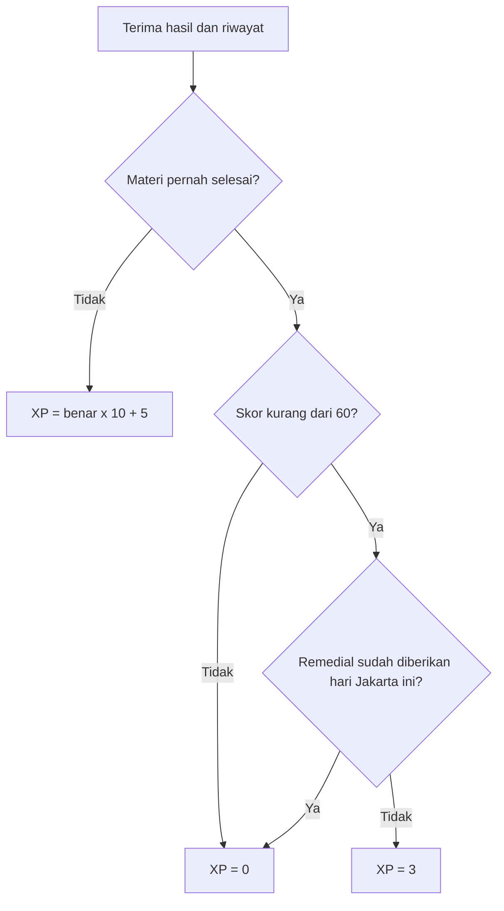

# Katalog pengujian white-box

Versi 1.0 — 18 Oktober 2026. Cakupan: **36 area pengujian**, pemetaan fungsi dan SQL, jalur keputusan, batas, state, dan coverage. Gunakan bersama [laporan aktual](LAPORAN-2026-10-18.md), bukan sebagai sertifikasi seluruh jalur sudah diuji.

## 1. Pendekatan dan alat

Unit test memakai `node:test` dan `node:assert/strict`. Integrasi komponen memakai happy-dom dan transform Vite. Layanan cloud diinjeksi mock pada `cloud-ui.test.mjs`. Pengujian SQL menjalankan migration dan RPC pada PGlite dengan simulasi role/Auth/Storage. Pengujian build memakai Vite dan audit bundle.

PGlite membuktikan perilaku SQL yang dijalankan pada harness, tetapi tidak membuktikan PostgREST/Data API, server Auth, email, jaringan, Storage service, policy pada proyek terpasang, atau konkurensi multi-koneksi Supabase nyata. Test DOM bukan pengukuran layout browser. Coverage Node hanya dihitung untuk berkas yang masuk laporan instrumentasi.

## 2. Matriks fungsi, cabang, dan bukti

Label **lokal** berarti assertion relevan tersedia dalam suite yang lulus. **Parsial** berarti ada sebagian assertion tetapi cakupan area lebih luas. **Lanjutan** adalah pekerjaan eksekusi/penambahan tes yang belum diklaim selesai. Lulusnya file tes tidak berarti setiap cabang dalam baris terkait tercakup.

Semua lokasi kode relatif terhadap root aplikasi. Tes tambahan berada di `tests/qa-boundaries.test.mjs` dan kelompoknya bernama `QA-WB-01`–`QA-WB-12`.

| ID | Target implementasi | Input/jalur dan expected result | Bukti lokal / pekerjaan lanjutan |
| --- | --- | --- | --- |
| WB-01 | `src/lib/config.js::readConfig` | Demo default; mode asing; kosong/placeholder; HTTPS sah/HTTP/rusak; publishable/secret; legacy anon/service-role. Konfigurasi salah menghasilkan error dan tidak fallback demo. | Lokal: `cloud-ui.test.mjs` konfigurasi + QA-WB-01. JWT hanya diperiksa format/role lokal; tanda tangan diverifikasi layanan Auth. |
| WB-02 | `ProtectedRoute.jsx` | `session=null` → login; role beda → penolakan; role cocok → Outlet; `/account` menerima sesi sah. | Lokal: `app.test.mjs` proteksi dan render halaman. Lanjutan: repeat dengan sesi cloud nyata. |
| WB-03 | `learning.js::safeImageUrl/youtubeEmbedUrl`, `MaterialRenderer.jsx` | HTTPS/aset sah diterima; tipe non-string, skema berbahaya, traversal, host tiruan/ID salah ditolak; iframe baru setelah klik. | Lokal: QA-WB-07/08; `app.test.mjs` renderer video. Visual/media jaringan: BB-033–035. |
| WB-04 | `learning.js::levelFromXp` | Nilai negatif/NaN-like dinormalisasi; floor desimal; batas 99/100/199/200; level dan progress benar. | Lokal: QA-WB-02 dan `learning.test.mjs`. Input Infinity di luar fixture XP database integer belum menjadi kontrak uji. |
| WB-05 | `learning.js::scoreDemoQuiz` | 4/11 soal ditolak; 5/10 diterima; duplikat ditolak; semua opsi harus integer valid; skor dibulatkan dan detail konsisten. | Lokal: QA-WB-03/04; `learning.test.mjs`. Assertion mencakup skor 0/100/67 dan jumlah benar. |
| WB-06 | `learning.js::shuffled` | Loop nol/satu/banyak elemen; RNG 0 dan mendekati 1; hasil berupa permutasi dan sumber tidak berubah. | Lokal: QA-WB-05; `learning.test.mjs`. Tidak menyimpulkan distribusi statistik dari satu sampel. |
| WB-07 | `learning.js::quizXp/jakartaDate` | Pertama → 10×benar+5; ulang skor >=60 →0; skor <60 + kuota belum terpakai →3; kuota hari sama →0; tanggal Jakarta berganti →reset. | Lokal: QA-WB-06 dan `learning.test.mjs`; SQL remedial pada `database.test.mjs`. |
| WB-08 | `DemoContext.jsx::completeReading/submitQuiz` | Peran salah, materi/sesi/soal asing ditolak; baca sekali; attempt replay tidak menggandakan hadiah. | Parsial: `app.test.mjs` alur baca/kuis; fungsi murni pada QA-WB. Lanjutan: uji setiap guard provider dan double-click browser. |
| WB-09 | `importService.js::parseCsv` melalui `validateImport` | State quoted/unquoted, escaped quote, CRLF/BOM, newline field; quote tak tertutup/posisi salah, header/kolom salah ditolak. | Lokal: QA-WB-12 dan `learning.test.mjs` CSV. Parser internal diuji melalui kontrak publik, tanpa mengekspor fungsi khusus tes. |
| WB-10 | `importService.js::validateImport` schema | Record null/array/nonobjek; ID asing; prompt/opsi/explanation tipe salah; 4 opsi unik trim-lower; kunci integer 0–3; trim dan difficulty fallback. | Lokal: QA-WB-10/11, `learning.test.mjs`. Periksa jalur normal dan error, bukan hanya panjang array valid. |
| WB-11 | `importService.js::validateImport` envelope | Array 0/1/200/201; JSON rusak; byte UTF-8 512000/512001; prompt 2000/2001, opsi 500/501, pembahasan 3000/3001. | Lokal: QA-WB-09/10. Angka byte bukan panjang karakter; batas server JSONB memiliki serialisasi berbeda. |
| WB-12 | `AdminPage.jsx`, RPC `import_questions` | Jika satu record gagal, UI tidak menyimpan bagian valid; transaksi server rollback; batch sama idempoten, actor lain tidak mengambil batch; status draf. | Lokal: `app.test.mjs` impor demo, `cloud-ui.test.mjs` RPC, `platform-database.test.mjs` atomisitas/idempotensi. Lanjutan: replay jaringan cloud. |
| WB-13 | `supabaseService.js::uploadFile/removeFile/signedFile` | MIME allowlist; size 0/>5MiB ditolak; path user/task/UUID; `upsert=false`; URL 60 detik; error upload diteruskan. | Parsial: `cloud-ui.test.mjs` validasi/path/TTL. Lanjutan: batas tepat 5MiB, error remove/upload dan isi MIME palsu; layanan Storage nyata. |
| WB-14 | `supabaseService.js::result/updateProfile` | Data sukses dikembalikan; error.message/fallback diteruskan; update hanya nama, kelas, avatar, tanpa role/XP. | Parsial: `cloud-ui.test.mjs` adapter/whitelist. Lanjutan: error tanpa message dan seluruh endpoint adapter. |
| WB-15 | `supabaseService.js::loadSnapshot` | Tamu hanya katalog; student memuat miliknya; tutor roster kelas miliknya; admin count/audit/request/profil; error query tidak menjadi data sukses. | Parsial: provider dites dengan mock snapshot; coverage langsung fungsi ini rendah. Tambahkan contract tests per role dan kegagalan masing-masing query; verifikasi Data API nyata. |
| WB-16 | `SupabaseProvider.jsx::refresh` / auth callback | Generation hanya menerima response terbaru; ganti akun menghapus state lama; token refresh tidak menghapus jawaban; unsubscribe pada cleanup. | Lokal: `cloud-ui.test.mjs` respons akun lama/token refresh/retry. Lanjutan: unmount dan auth event saling mendahului pada browser nyata. |
| WB-17 | `SupabaseProvider.jsx::mutate/submitQuiz` | Task gagal → error; task sukses + refresh gagal tidak mengulang mutasi; akun berubah selama submit → hasil lama ditolak; resync saat online/visible. | Parsial: `cloud-ui.test.mjs` beberapa jalur akun/submit. Lanjutan: fault injection task sukses-refresh gagal dan event online; BB-108/109. |
| WB-18 | `DemoContext.jsx::loadState` | JSON rusak/versi salah/grade invalid/array invalid → fallback; state valid dipulihkan; role liar tidak menjadi sesi. | Parsial: `app.test.mjs` persistensi normal. Lanjutan: test fixture corrupt untuk setiap guard, BB-061. |
| WB-19 | `DemoContext.jsx` efek localStorage | setItem sukses → notice kosong; throw SecurityError/quota → notice gagal dan app tetap hidup. | Lanjutan: injeksi storage yang melempar error, BB-062; belum dibuktikan oleh tes persistensi normal. |
| WB-20 | Profil dan otorisasi XP | Nama/kelas/avatar valid tersimpan; payload role/XP tidak dapat menaikkan hak; SQL melarang akses profil pihak lain. | Lokal: `cloud-ui.test.mjs` whitelist, `database.test.mjs` RLS/role/XP. UI boundary nama/kelas: BB-010/057. |
| WB-21 | Migration 001 `handle_new_user`, policy profiles | Metadata mencoba role admin/XP ditimpa aturan student; student hanya melihat/mengubah kolom yang diizinkan. | Lokal: `database.test.mjs` trigger dan RLS. Lanjutan: signup Auth sungguhan dan REST request langsung. |
| WB-22 | RPC `get_lesson_quiz` | Student saja; materi published/subject aktif; limit 5–10; >=5 soal lengkap; resume attempt aktif; respons tanpa key; snapshot stabil. | Lokal: `database.test.mjs` sesi/katalog/snapshot. Lanjutan: dua koneksi start serentak pada cloud. |
| WB-23 | RPC `submit_quiz_answers/get_quiz_result` | Pemilik sesi; tepat seluruh ID sekali; integer opsi; skor server; replay identik idempoten; jawaban berbeda pascaselesai ditolak; hasil hanya pemilik. | Lokal: `database.test.mjs` malformed answers/skor/replay/ownership. Lanjutan: konkurensi cloud, BB-056. |
| WB-24 | Attempt expiry dan publikasi | Attempt expired ditolak; bank berubah tidak mengubah snapshot yang sudah dibuat; materi tidak tersedia tidak boleh diberi hadiah baru. | Lokal: `database.test.mjs` expiry/snapshot/draft-inactive. Uji state publish/unpublish saat sesi aktif di staging sebagai tambahan. |
| WB-25 | Rate limit dan pemberian XP SQL | 20 sesi baru/jam; baca sekali; first_quiz per materi; remedial per tanggal Jakarta global; tutor tidak memperoleh XP siswa. | Lokal: `database.test.mjs`. Kuota pada koneksi bersamaan belum terbukti oleh PGlite satu harness. |
| WB-26 | RPC `create_class/join_class` | Tutor membuat kelas valid; student join tingkat cocok; salah kode tercatat; 10 percobaan/jam; join ulang tidak menggandakan anggota. | Lokal: `platform-database.test.mjs` create/join/limit. Lanjutan: batas 100 kelas/tutor dan benturan random kode. |
| WB-27 | RPC `create_assignment/submit_assignment` | Pemilik kelas + materi published setingkat + tenggat depan; anggota menjawab sebelum deadline; nilai sudah ada mengunci kiriman; path lampiran sesuai. | Lokal: `platform-database.test.mjs` tugas/kiriman. Lanjutan: batas karakter dan waktu persis pada layanan nyata. |
| WB-28 | RPC `grade_submission` / award_xp | Tutor pemilik; skor 0–100; feedback 1–2000; hadiah +15 pertama; regrade tanpa hadiah ulang. | Lokal: `platform-database.test.mjs` penilaian dan `app.test.mjs` siswa-tutor. Lanjutan: dua grader/request serentak. |
| WB-29 | Policy kelas, anggota, tugas, kiriman | Matriks read/write tamu/student/tutor/admin dan pemilik/nonpemilik; direct table/RPC sama-sama mematuhi izin. | Parsial: `platform-database.test.mjs` isolasi. Lanjutan: Data API/REST dan audit policy terpasang; admin tidak otomatis berhak semua operasi siswa/tutor. |
| WB-30 | RPC `save_lesson/get_editor_questions/save_draft_question` | Tutor hanya draf miliknya; admin sesuai hak; 4 opsi unik, kunci 0–3, konten/media aman; edit ID asing ditolak. | Lokal: `platform-database.test.mjs` editor/konten. Lanjutan: boundary panjang field seluruh editor dan replay UI save gagal. |
| WB-31 | RPC `publish_lesson/promote_tutor/save_subject/get_audit_log` | Admin-only; review true; >=5 soal lengkap; publish semua soal; promosi hanya siswa→tutor; audit privat. | Lokal: `platform-database.test.mjs` publish/role/audit, `cloud-ui.test.mjs` review checkbox. Lanjutan: status batal/rollback setiap error endpoint. |
| WB-32 | Migration 003 file policy dan deletion request | Private bucket; user/task path; pemilik/tutor kelas sah saja; request akun milik sendiri dan tidak langsung menghapus. | Lokal: `platform-database.test.mjs` policy file/deletion. PGlite memakai stub Storage; penghapusan Auth/objek sungguhan memerlukan staging. |
| WB-33 | Draf kurikulum/generator/manifest | 216 unit, 1080 soal valid; SQL draf/idempoten; manifest tanpa opsi/kunci; beberapa contoh matematika sesuai oracle. | Lokal: `curriculum.test.mjs`, `platform-database.test.mjs`. Lulus schema/jumlah bukan persetujuan kualitas semua materi. |
| WB-34 | Buku Matematika kelas 1 | 8 bab/25 subbab/40 soal; urutan benar; SQL draf/idempoten/tidak menimpa edit; manifest tanpa bank kuis. | Lokal: `textbooks.test.mjs`, `platform-database.test.mjs`, `app.test.mjs`. Peninjauan guru dan visual tetap terpisah. |
| WB-35 | Referensi CP dan sumber | 25 kelompok/109 CP SD; sumber dapat direkonstruksi; fase/lampiran di luar cakupan tidak diambil; pengayaan/cabang seni benar. | Lokal: `cp-reference.test.mjs`, `resources.test.mjs`, `app.test.mjs`. Tautan eksternal live tidak seluruhnya diverifikasi pada run ini. |
| WB-36 | Production build dan audit | Mode Supabase tidak memuat demoCatalog/dummyData/DemoContext/src-content; CP dimuat dinamis; audit bundle lulus. | Lokal: `production-build.test.mjs` build offline; build demo terpisah. Deployment dan konfigurasi produksi nyata belum diuji. |

## 3. Analisis percabangan fungsi XP

Alur `quizXp` dapat ditinjau tanpa mengandalkan UI:

| Jalur | Pernah selesai | Skor <60 | Remedial tanggal sama | Expected | Bukti |
| --- | --- | --- | --- | --- | --- |
| XP-1 | Tidak | Apa pun | Apa pun | `correct_count*10+5` | QA-WB-06: benar 0 →5; tes lama benar 2 →25 |
| XP-2 | Ya | Tidak, batas 60 | Tidak/Ya | 0 | QA-WB-06 |
| XP-3 | Ya | Ya, batas 59 | Tidak | 3 | QA-WB-06 |
| XP-4 | Ya | Ya | Ya, materi lain sekalipun | 0 | QA-WB-06 |
| XP-5 | Ya | Ya | Ada kemarin, tidak hari ini | 3 | QA-WB-06 pada pergantian tanggal |

Ini basis jalur untuk fungsi tersebut, bukan pengukuran cyclomatic complexity seluruh aplikasi. MC/DC, mutation score, dan coverage SQL belum diukur dan tidak boleh diberi angka rekaan.

## 4. State transition yang harus diuji

| Objek | Transisi sah | Transisi yang ditolak / invariant |
| --- | --- | --- |
| Sesi aplikasi | Guest → student/tutor/admin sah → logout → guest | Peran dari metadata/payload tidak boleh menjadi eskalasi |
| Snapshot akun | Loading → ready; gagal → retry; account A → B | Respons A yang terlambat tidak boleh menimpa B |
| Attempt kuis | Baru → aktif → selesai; aktif → expired | Expired tidak dapat disubmit; selesai tidak bisa diubah; replay tidak memberi hadiah kedua |
| Materi | Draf → reviewed/publish → published → unpublish | Tanpa review/soal cukup tidak boleh publish; tutor tidak mengubah draf orang lain |
| Kiriman tugas | Belum ada → terkirim → diubah sebelum dinilai → dinilai → regrade | Setelah dinilai siswa tidak mengubah jawaban; regrade tidak mengulang XP |
| Impor | Input → validasi → seluruh batch tersimpan draf | Satu item salah tidak boleh menghasilkan commit parsial; batch ID mencegah duplikasi |
| Penghapusan | Tidak ada → pending → diproses pemilik staging | Menekan minta hapus tidak otomatis menghapus akun; pending privat |

## 5. Partisi dan boundary suite

| Parameter | Valid | Tidak valid / edge | Expected |
| --- | --- | --- | --- |
| Jumlah soal kuis | 5, 10 | 4, 11, ID ganda | Tolak invalid |
| Opsi terpilih | Integer 0–3 | -1, 4, pecahan, string, null, undefined, boolean | Tolak invalid, tidak coercion string |
| Skor remedial | 0–59 pada ulang | 60–100 | Hanya <60 memenuhi syarat; masih tunduk kuota |
| Level | 0, 99, 100, 199, 200 | Negatif, nilai tidak numerik | Normalisasi aman sesuai fungsi |
| Jumlah item impor | 1, 200 | 0, 201, envelope bukan array | Tolak envelope invalid |
| Ukuran input impor lokal | 512000 byte | 512001 byte | Hitung UTF-8 byte; bukan karakter |
| Prompt impor | Teks nonblank sampai 2000 | Blank, tipe lain, 2001 | Error item |
| Opsi impor | Empat teks unik sampai 500 | 3/5 item, null, case/trim duplicate, 501 | Error item |
| Explanation | Teks nonblank sampai 3000 | Blank, 3001 | Error item |
| Lampiran | MIME sah; 1..5242880 byte | 0, 5242881, MIME tidak sah | Tolak invalid; batas tepat perlu kasus Storage staging |
| Nilai tugas | 0, 100 | -1, 101 | Tolak invalid |
| Kelas | 1, 6 | 0, 7, pecahan | Tolak invalid |
| Tanggal remedial | 23:59:59 →00:00:00 WIB | Zona perangkat berbeda | Mengikuti tanggal Asia/Jakarta |

## 6. Cara membaca coverage dan prioritas perbaikan tes

Lihat angka run akhir pada [laporan](LAPORAN-2026-10-18.md). Coverage 100% line berarti baris yang terinstrumentasi dieksekusi; tidak membuktikan seluruh kombinasi data, kondisi, dan race sudah diuji. Data konten yang diimpor turut menaikkan persentase global. JSX hasil transform/harness dan SQL tidak muncul sebagai coverage sumber lengkap pada laporan ini.

Prioritas lanjutan: contract test `loadSnapshot` per role dan error query; storage boundary/failure; provider mutation berhasil tetapi refresh gagal; localStorage rusak/tidak dapat ditulis; browser E2E dan konkurensi Supabase. Tambahkan assertion pada perilaku/efek data, bukan hanya mock pernah dipanggil.

Strategi mutation test berikutnya: ubah sementara operator `<60` menjadi `<=60`, hapus pemeriksaan duplikat, longgarkan batas opsi, atau hilangkan generation check pada branch uji terisolasi. Suite harus gagal untuk mutasi relevan; pengujian mutation ini belum dieksekusi. Jangan mengubah kode kerja pengguna hanya untuk menciptakan angka coverage.
